Caleb Tisler 

# Project Description And Diagram
## Diagram
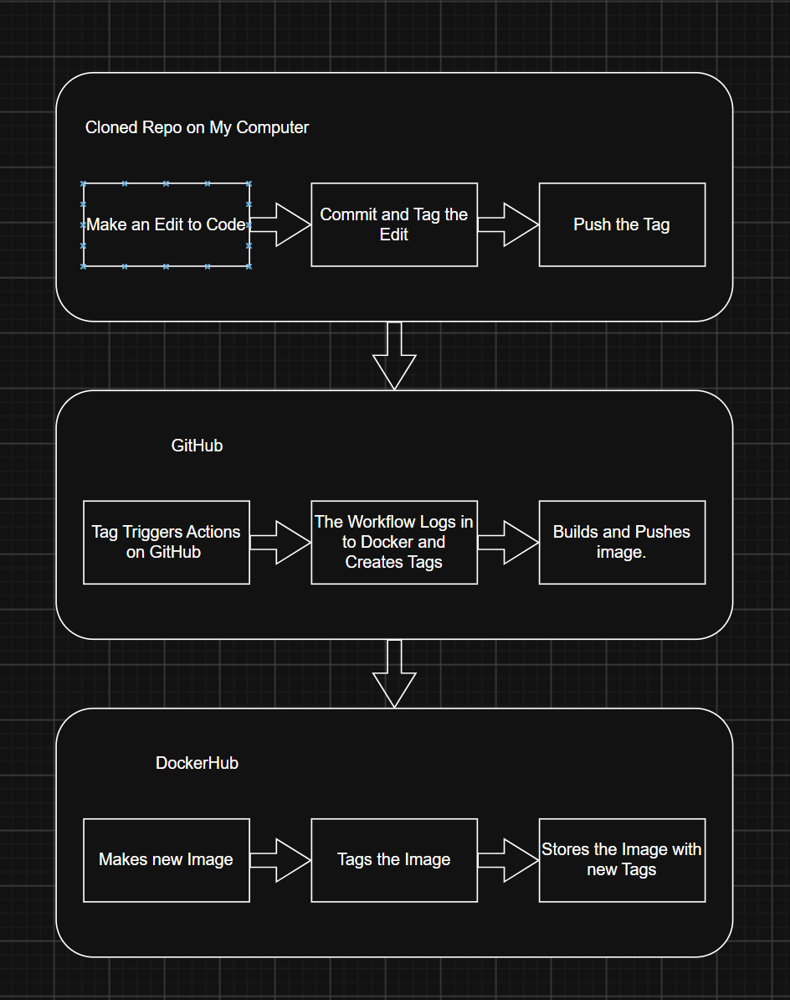
## Documentation
### Continuous Integration Project Overview
- The goal of this project is to create a workflow to automaticly builds a new image of my website on Docker when i push a new tagged version on GitHub
- The tools used are:
  - GitHub, to store the workflow and website code, and use it to tag and push versions of the website with GitHub actions that run the workflow.
  - Docker and DockerHub, to make the website image using the Dockerfile and to store the image versions   
### Resources Section

# Part 1

## Dockerfile & Building Images
### Website Content
- [index.html](web-content/index.html) : this is the link to the web pages index page that has a button to go to the secret page
- [secret.html](web-content/secret.html) : this is the link to  the web pages secret page that has a button to go to the index page
- [style.css](web-content/style.css) : this is the link to the websites style sheet that formats the design of the website

### Dockerfile
- [Dockerfile](Dockerfile) : this docker file contains `FROM httpd:2.4` which is where the image builds from and `COPY ./ /usr/local/apache2/htdocs/` which copies everything in [web-content](web-content/) into `/usr/local/apache2/htdocs/`.

### Building Image
I used `docker build -t armedpotatochip/button-site:latest .` within the web-contents folder of the repo

### Running Container
I used `docker run -d --name buttontest -p 8080:80 armedpotatochip/button-site:latest` within the web-contents folder of the repo

# Part 2

## Configuring GitHub Repository Secrets
- To create the PAT you must go to your docker account setting on docker and under personal accesss token make one with read and write settings
- To create Github Action Secrets you must go to the repos settings and in there there under Secrets and Variables you can click actions to make Those action secrets
- The secrets used for this project are : DOCKER_USERNAME, which is my docker user; DOCKER_TOKEN, which is my PAT token created

## CI with GitHub Actions
- When a commit is pushed on main the workflow is ran

- The first step is "Login to Docker Hub" which uses `docker/login-action@v41` and the secrets DOCKER_USERNAME and DOCKER_TOKEN to log into docker hub
-  The next step is "Set up Docker Buildx" which uses `docker/setup-buildx-action@v4` to set up the building of the image
-  The Last step is "Build an Push" which uses `docker/build-push-action@v7` to build the image and push it to docker hub

- if this workflow is used in a different repo the you would need to change:
  - The workflow tags would be different for the image
  - The repo secrets would need to be added to the new repo with ist of PAT and docker username
 
[Workflow at Part 2](https://github.com/WSU-kduncan/ceg3120-cicd-tisler4-f26/blob/40e9be54d0c932c1aad8f518ffba01c8f54d0cf5/README-CI.md)

### Testing & Validating
- one a recent push to main, in the actions tab, check the time stamp of that push an the green check mark. On Docker Hub you can check the repositories tab and match the time stamps to make sure the workflow did its task.
- I pulled and ran the image with `docker run -d -p 8080:80 armedpotato/button-site:latest` since i did not find the image locally it pulled from docker hub.
- link to docker repo [armedpotato/button-site](https://hub.docker.com/r/armedpotato/button-site)

# Part 3
## Generating tags
- To see your tags in your git repository use `git tags`
- To generate a tag in a git repository use `git tag -a v1.0.0`
- To push a tag to Github from the git repo use `git push origin v1.0.0`

## Semantic Versioning Container Images with GitHub Actions
- The workflow will now one run if the commit has a tag with it
- the workflow step added was "Docker meta" that uses the `docker/metadata-action@v6` with will use the git tag to generate the images tag
- if this workflow is used in a different repo the you would need to change:
  - The workflow tags would be different for the image
  - The repo secrets would need to be added to the new repo with ist of PAT and docker username

[Workflow at Part 3](.github/workflows/docker.yml)

## Testing and Validation
- you can see that the workflow did its task by looking in the actions tab and checking for the green checkmark
- you can see the image on DockerHub working when you run both versions of the image using different versions at the same time
- link to docker repo [armedpotato/button-site](https://hub.docker.com/r/armedpotato/button-site)

# Images
### 1) Local run - docker ps showing your container running, and a browser showing both of your pages with your CSS applied.
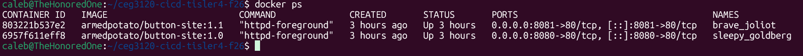
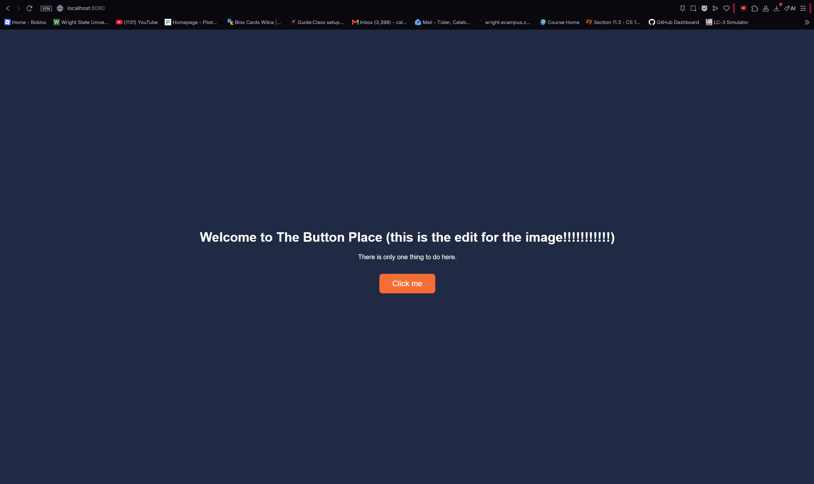
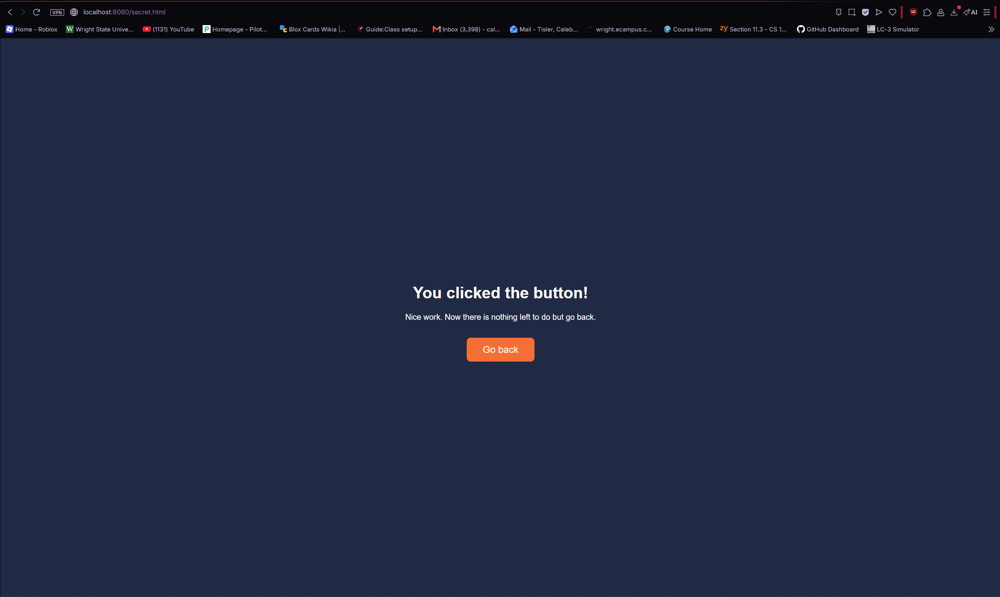

### 2) Repository secrets - your repository's Actions secrets page showing DOCKER_USERNAME and DOCKER_TOKEN. Secret values are not displayed - never show or commit them.
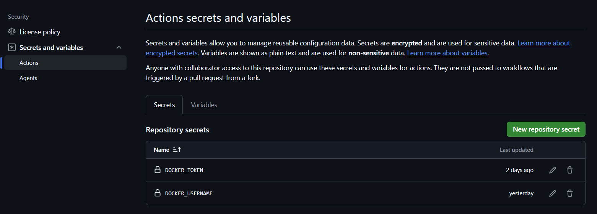

### 3) Main trigger - a successful workflow run from a push to main, with the commit SHA visible.
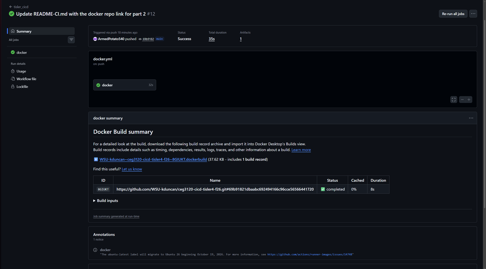

### 4) Branch negative test - push a commit to a branch other than main, and show the commit on that branch and that no workflow run started.
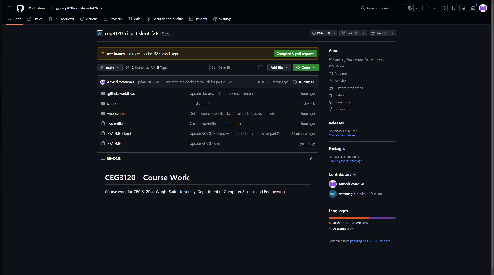
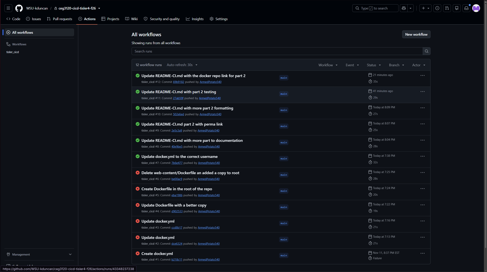

### 5) Change to image - change visible text on your site and push it to main. After the workflow succeeds, pull and run the new image and show the change in a browser.

### 6) Tag trigger - git tag -l output, and a successful workflow run with a tag as its event.
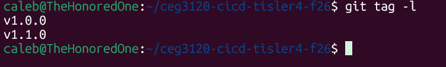
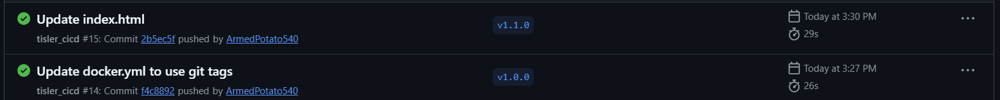

### 7) Tag negative test - push a commit without a tag, and show the commit and that no workflow run started.
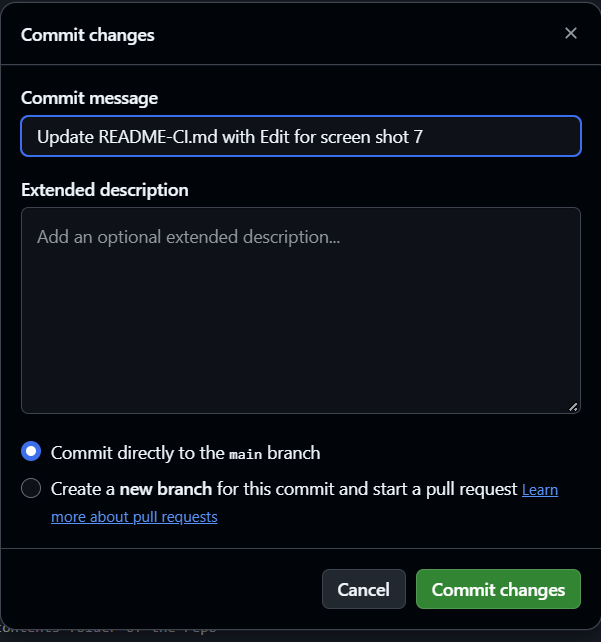
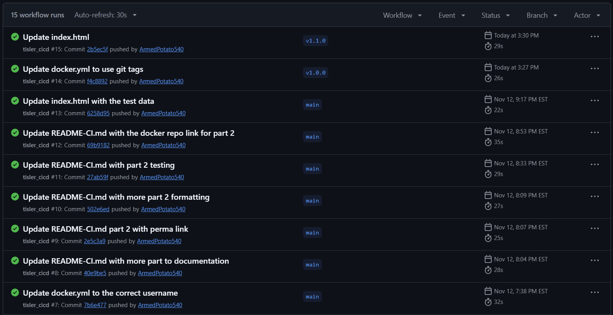

### 8) Tag set - your DockerHub repository's tags showing latest, major, and major.minor.

### 9) Two releases - after your second release (for example, v1.0.0 then v1.1.0), your DockerHub tags and digests showing that 1 and latest moved to the new image while 1.0 stayed on the old image.

### 10) Rollback - run containers from your major.minor tags (for example, :1.0 and :1.1) and show in a browser that each serves its version of the site.

